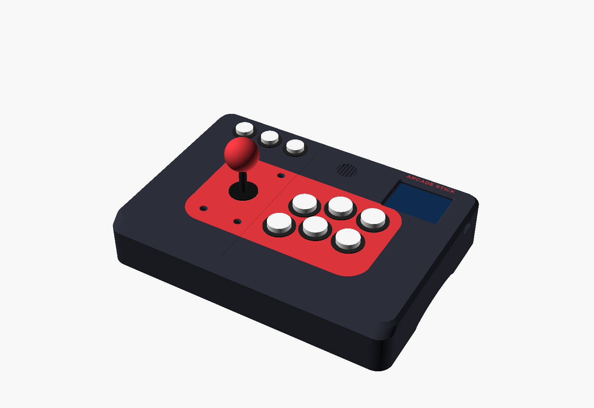

# Arcade Stick case v2

A new, cleaner case for the arcade stick. It's 310 × 220 × 55 mm and fits a Sanwa JLF, six 30 mm buttons in a Vewlix layout, START / SELECT / HOME (24 mm), the Freenove 2.8" screen, the I/O board, the speaker and a 1S LiPo.

What's different from the first case:

- **Palm bevel:** the front edge has a 12 mm, 45° bevel where your wrists rest. The other top edges have a 4 mm, 45° chamfer.
- **Finger scoops:** shallow scoops under the left and right sides make it easy to pick up and hold on your lap.
- **Two-colour top:** a play-area panel around the stick and buttons, plus the ARCADE STICK name by the screen, print in a second colour. They're 3 layers deep, printed first, because the top prints face down.
- **Hidden seam:** the joint between the two top halves runs between the stick and the buttons. A thin design line on the top makes it look deliberate.
- **Bevelled screen window.** The USB-C port sits in a recess in the right side, so you can charge and flash with the case closed.
- **Speaker grille** in the top, with a ring underneath to hold the speaker.

## What to print

Everything prints on the Bambu X1 Carbon's 256 × 256 mm bed with **no supports**.

| File | Qty | How to print |
|---|---|---|
| `stl/top_left.stl` + `stl/accent_left.stl` | 1 | **Face down** (as exported). Load both together as one object (see below). |
| `stl/top_right.stl` + `stl/accent_right.stl` | 1 | Same. |
| `stl/base_left.stl` | 1 | Flat, as exported |
| `stl/base_right.stl` | 1 | Flat, as exported |
| `stl/splice.stl` | 2 | Flat |
| `stl/screen_clip.stl` | 4 | Flat |

Suggested settings: PLA or PETG, 0.2 mm layers, 4 walls, 20 % gyroid infill, textured PEI plate (gives the top a nice finish).

### Two colours in Bambu Studio

1. Drag **top_left.stl** into Bambu Studio.
2. Right-click it → **Add part** → **Load…** → choose **accent_left.stl**. Both files share the same origin, so the accent drops into place.
3. In the object list, set the top to your body colour (e.g. black) and the accent part to your stick's colour (e.g. red).
4. Do the same for the right half.

If you only want one colour, print `top_left.stl` and `top_right.stl` on their own. The play area will be 0.6 mm lower, which also looks fine.

## Parts you need

| Part | Qty | Notes |
|---|---|---|
| M4 × 12 countersunk screws + M4 nyloc nuts | 4 | Joystick plate (Sanwa JLF-P1, turned so its long side runs front to back) |
| M3 × 10 countersunk screws | 12 | Base plate into the case's posts |
| M3 × 10 pan-head self-tapping screws | 8 | The two splices |
| M3 × 8 pan-head self-tapping screws | 7 | 4 screen clips, 3 I/O board |
| 1.75 mm filament, cut into 12 mm pins | 10 | Lines up the two top halves |
| Rubber feet, 12 mm round, about 1.5 mm thick | 4 | They sit in recesses in the base |
| Glue: plastic epoxy or thick CA | | For the top seam |
| Double-sided foam tape | | Holds the battery in its bay |

All screw holes are 2.5 mm pilot holes for screws that cut their own thread. If you'd rather use M3 heat-set inserts, change `PILOT = 2.5` to `PILOT = 4.0` in the `.scad` file and run `export.sh`.

## Putting it together

1. **Join the top halves.** Push filament pins into the holes along one seam face, so half of each pin sticks out. Put glue on both seam faces and press the halves together on a flat surface. Screw a **splice** across the seam at the front and the back (4 screws each). Wipe off any glue that squeezes out, then leave it to cure.
2. **Buttons.** Snap the six 30 mm and three 24 mm buttons in from the top. Left to right along the back: **SELECT, HOME, START**.
3. **Joystick.** Take the ball and dust washer off the JLF. From underneath, push the shaft up through the big hole with the mounting plate's long side running front to back. Fit the four M4 countersunk screws from the top, add the nuts underneath, then refit the dust washer and ball.
4. **Screen.** Put the screen face down into its frame under the window, with the **USB-C end against the right-hand wall**. Check that the port lines up with the hole in the side. Screw the four clips over the board's corners. If the picture is upside down, use **Menu → Flip screen**.
5. **Speaker.** Press it into the ring under the grille. A dab of hot glue holds it.
6. **I/O board.** Screw it onto the three posts at the front of the base plate, with the components facing up. The posts only line up one way round.
7. **Battery.** Stick it into the bay on the left of the base plate with foam tape.
8. **Wire it all up.** The firmware manual and `hardware/io-board/README.md` show which terminal each input goes to. Then open **Menu → Input test** and press everything.
9. **Close it.** Lay the base halves into the bottom (the lap joint overlaps in the middle) and fit the 12 countersunk screws. Stick the rubber feet into their recesses.

## Measurements to check before you print

These come from datasheets, not from measuring a real board. Check them with calipers. If any differ, change the number near the top of `arcade_stick_case.scad`, then run `export.sh` again.

| What | Setting | Value used |
|---|---|---|
| Screen board size | `SCR_L`, `SCR_W`, `SCR_D` | 86 × 50 × 4.4 mm (LCDWIKI ES3N28P spec sheet) |
| Where the visible screen sits along the board | `SCR_VIS_SHIFT` | 0: centred on the 69.2 mm glass |
| USB-C position along the board's short edge | `USB_Y` | Middle of the edge |
| Speaker diameter | `SPK_D` | 28 mm |
| Battery bay | `BAT` | 52 × 80 mm inside |
| Joystick plate | `JLF_SCREWS` | Sanwa JLF-P1: slots 84 × 40 mm, 95 × 53 mm plate (Focus Attack / Akihabara Shop drawing) |

Button holes are 30.3 mm and 24.3 mm. The panel is thinned to 3 mm around each one, so Sanwa snap-in buttons clip in. If your printer makes holes tight, increase `HOLE30` / `HOLE24`.

## Editing the design

`arcade_stick_case.scad` is OpenSCAD and fully parametric. Every size is a named setting at the top. The origin is the joystick's centre. `export.sh` writes all the STL files and the preview images. Setting `part="check_0"` … `"check_7"` gives a fit check for each inside part (joystick plate and body, both button sizes, screen, I/O board, battery, speaker): it should come out empty.
