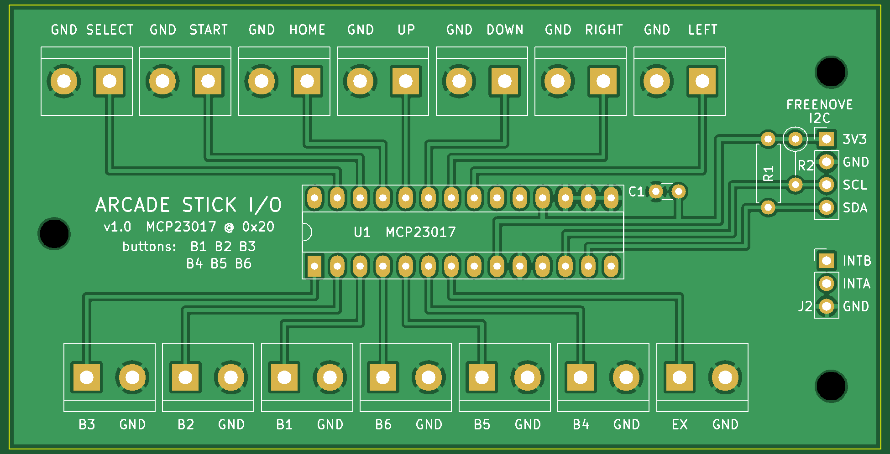
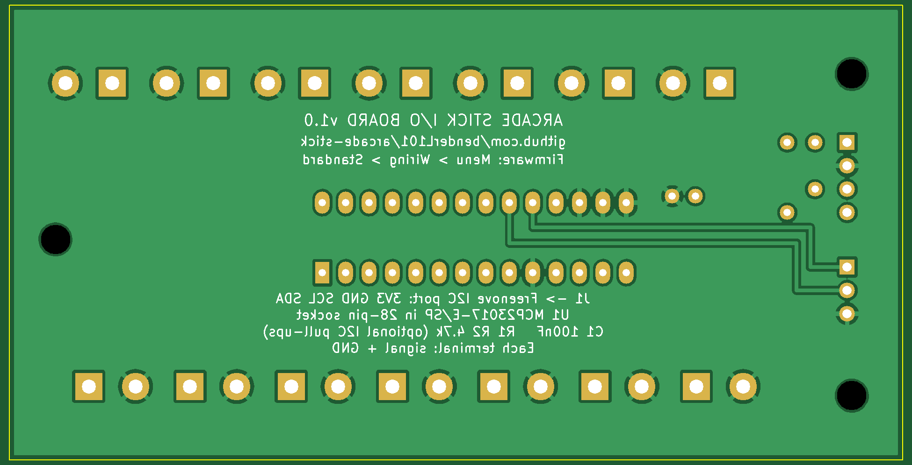

# Arcade Stick I/O board v1.0

A small through-hole board that replaces the loose MCP23017 module and its hand-soldered wiring. Every button and stick direction gets its own screw terminal (signal + GND). The terminals are labelled and laid out to the firmware's **standard wiring**, so a new stick works with **Menu → Wiring → Standard** (the default).

| Front | Back |
|---|---|
|  |  |

- Size: **97 × 49.5 mm**, 2 layers, 3 × M3 mounting holes. That's under 10 × 10 cm, so it gets JLCPCB's cheapest price.
- Everything is through-hole, so it can be soldered with an ordinary iron.
- Tallest parts: the screw terminals (about 10 mm) and the chip in its socket (about 8 mm). Allow roughly 12 mm above the board inside the case.

## Ordering from JLCPCB

1. Go to jlcpcb.com, click **Order now** and upload `ArcadeStick_IO_v1.0_JLCPCB.zip`. Don't unzip it.
2. Leave the defaults: 2 layers, 1.6 mm thick, quantity 5. It reads the size by itself (97 × 49.5 mm).
3. Pick any colour. Green is quickest and cheapest.
4. Optional: **Remove order number → Yes** (small extra fee). Otherwise JLCPCB prints a small code somewhere on the board.
5. Don't add assembly (PCBA). You'll solder the parts yourself.
6. At checkout, the cheapest shipping (Global Standard Direct Line) takes a couple of weeks. DHL is faster but costs more.

## Parts (per board)

| Ref | Part | Qty | Notes |
|---|---|---|---|
| U1 | MCP23017-E/SP (DIP-28, through-hole) | 1 | e.g. Core Electronics, element14 |
| U1 socket | 28-pin **narrow** (0.3") IC socket | 1 | So the chip can be swapped |
| JT1–JT7, JB1–JB7 | 2-way PCB screw terminal, 5 mm / 5.08 mm pitch | 14 | e.g. Jaycar HM3172 |
| J1 | 4-pin 2.54 mm male header | 1 | For the Freenove I2C cable's Dupont ends |
| J2 | 3-pin 2.54 mm male header | 1 | Optional: spare interrupt pins for later |
| R1, R2 | 4.7 kΩ resistor, 1/4 W | 2 | I2C pull-ups. Fit them: harmless if the Freenove board has its own |
| C1 | 100 nF ceramic capacitor (2.5 mm lead spacing) | 1 | Decoupling |

## Soldering

Go from lowest to tallest:
1. R1, R2 (R2 stands upright) and C1.
2. The 28-pin socket. Its **notch goes on the left**, matching the half-circle on the board outline.
3. J1 (and J2 if you want it).
4. The 14 screw terminals. Put the wire openings facing the **board edge**, where the labels are.
5. Push the MCP23017 into the socket, **notch on the left**. Pin 1 is the square pad, bottom left.

## Wiring

- **J1 → Freenove I2C port:** 3V3 → 3V3, GND → GND, SCL → SCL, SDA → SDA. Each pin is labelled on the board.
- **Buttons and stick:** each wire goes to the terminal with its name. Each terminal has a GND screw beside it. With a daisy-chained ground you only need one GND connection; the rest can stay empty.
  - Top row: SELECT, START, HOME, UP, DOWN, RIGHT, LEFT.
  - Bottom row: B3, B2, B1, B6, B5, B4, EX. These are in chip-pin order. B1–B3 are the top row of buttons, left to right, and B4–B6 the bottom row.
- **Firmware:** leave **Menu → Wiring** on **Standard**. Then open **Menu → Input test** and press every button and direction to check each one lights up correctly.

## Checks done on this design

- **KiCad design-rule check:** 0 violations, 0 unconnected pads. The rules are 0.25 mm clearance, 0.4 mm signal traces and 0.5 mm power traces.
- **`check_board.py`:** confirms these against the finished board file:
  - every MCP23017 pin against Microchip's datasheet pinout
  - every terminal against `MCP_BIT_STD` in `src/main.cpp`
  - the exact pad list of every net, and the label beside each terminal
- **Gerber renders:** the images above are drawn from the Gerber files themselves. Drill count: 34 × 0.8 mm, 7 × 1.0 mm, 28 × 1.52 mm and 3 × 3.2 mm (NPTH).
- **Not yet built:** the first boards are the real test.

## Remaking the files

```bash
python3 make_board.py           # writes arcade_stick_io.kicad_pcb (KiCad 7)
python3 fill_drc.py arcade_stick_io.kicad_pcb   # fills the ground pours, writes the DRC report
python3 check_board.py          # netlist / firmware / label checks
kicad-cli pcb export gerbers -o gerbers/ -l F.Cu,B.Cu,F.Mask,B.Mask,F.Silkscreen,B.Silkscreen,Edge.Cuts --no-x2 --subtract-soldermask arcade_stick_io.kicad_pcb
kicad-cli pcb export drill -o gerbers/ --format excellon --drill-origin absolute --excellon-units mm --excellon-separate-th arcade_stick_io.kicad_pcb
```
Set `KICAD7_FOOTPRINT_DIR=/usr/share/kicad/footprints` if KiCad's library table can't find the footprints.
